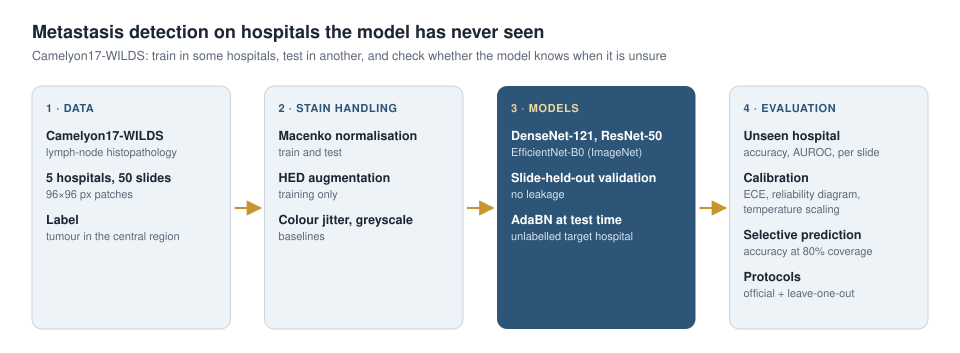

# Breast-Cancer Metastasis Detection Across Hospitals

Detection of breast-cancer metastases in lymph-node histopathology with CNNs, evaluated on hospitals that the model has never seen during training.

## Motivation

Finding small metastases in lymph-node slides is slow work for pathologists, and CNNs do it well inside the hospital they were trained in. Slides from another hospital look different, though: staining, reagents and scanners change the colours and textures, and accuracy can drop sharply while the model stays confident. This project measures that drop on Camelyon17-WILDS (five hospitals), compares the common remedies, and checks whether the model's confidence can still be used to decide which patches should go to a pathologist.

## Approach

- Data: Camelyon17-WILDS, 96×96 px patches from 50 lymph-node slides of five hospitals.
- Protocols: the official WILDS hospital split, and leave-one-hospital-out over all five hospitals.
- Validation uses held-out patients from the training hospitals. The test hospital is never used for model selection; selection on the out-of-distribution validation hospital (as in WILDS) is reported separately.
- Stain handling: Macenko normalisation, HED stain augmentation, colour jitter and greyscale, compared on the same models and splits.
- Test-time adaptation: AdaBN, which re-estimates batch-norm statistics on unlabelled patches of the new hospital.
- Models: DenseNet-121, ResNet-50 and EfficientNet-B0.
- Evaluation: accuracy, AUROC and per-slide accuracy on the unseen hospital; calibration (ECE, reliability diagrams, temperature scaling); accuracy on the most confident 80% of patches.

The full experiment design is in [docs/DESIGN.md](docs/DESIGN.md).

## Progress

- [x] Camelyon17-WILDS loading with official and leave-one-hospital-out protocols
- [x] Patient-level validation without leakage
- [x] Macenko normalisation, HED augmentation and colour baselines
- [x] AdaBN test-time adaptation
- [x] Calibration and selective prediction metrics
- [x] Dataset exploration figures
- [x] Unit tests, end-to-end test and Colab notebook

Next:

- [ ] Stain handling comparison on the official split
- [ ] Leave-one-hospital-out experiments

## Code

The implementation (data pipeline, stain methods, training and evaluation scripts, tests and a Colab notebook) is kept in a private repository for now. I am happy to share it on request.

## Data

Camelyon17-WILDS (CC0), derived from the CAMELYON17 challenge.

## References

- P. Bándi et al. From Detection of Individual Metastases to Classification of Lymph Node Status at the Patient Level: The CAMELYON17 Challenge. IEEE TMI, 2019.
- P. W. Koh et al. WILDS: A Benchmark of in-the-Wild Distribution Shifts. ICML, 2021.
- M. Macenko et al. A method for normalizing histology slides for quantitative analysis. ISBI, 2009.
- D. Tellez et al. Quantifying the effects of data augmentation and stain color normalization in convolutional neural networks for computational pathology. Medical Image Analysis, 2019.
